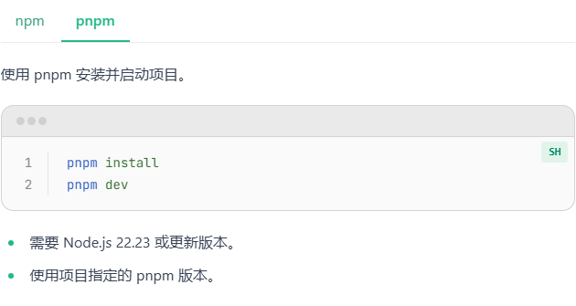
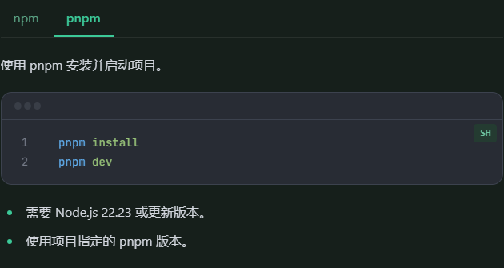
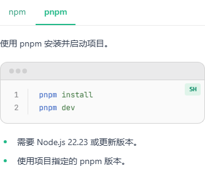

# Code groups

Firefly uses `rehype-code-group` for Markdown code tabs, with Expressive Code for highlighting, code titles, line numbers, diffs, folding and copy buttons. The live examples are in `src/content/posts/code-examples.md`; the browser tests use their own fixture, `src/e2e/code-groups.md`.

## Integration

- Keep Astro's existing `unified()` Markdown processor. This integration does not switch the site to Satteri.
- Run `rehype-code-group/package-managers` and `rehype-code-group/remark` before directive and section processing. They add `npm2yarn` conversion and fence-meta labels inside groups.
- Run the rehype plugin before Expressive Code transforms the individual code blocks. `astro-expressive-code` appends its rehype plugin to the configured processor.
- Set `assets: "none"`. `CodeGroupManager.astro` loads the stylesheet and the package client once, without per-article inline scripts or a second set of tab handlers.
- Keep `fullEmojiResolver` to preserve the full shortcode catalog used by earlier Firefly versions.
- Theme via `--rcg-*` variables in `src/styles/expressive-code.css`. A print override in Tailwind's `base` layer ensures its important `[hidden]` reset cannot suppress inactive panels when printing.

The package client enhances groups inserted by Swup through its mutation observer. No additional Swup callbacks or per-navigation event listeners are necessary. JavaScript-disabled pages retain every panel; printing also shows every panel with its label.

## Authoring

Existing `::: code-group labels=[...]` groups continue to work. Each compact tab contains one Markdown block. Use rich groups when explanatory text, lists and code should switch together:

````markdown
:::: code-group label="Installation"

::: code-tab label="npm"

Install dependencies before starting the development server.

```sh
npm install
npm run dev
```

The terminal needs to stay open while you preview the site.

:::

::: code-tab label="pnpm"

```sh
pnpm install
pnpm dev
```

:::

::::
````

Leave blank lines around marker lines. Optional rich-group attributes include `default`, `sync`, `persist` and `orientation="vertical"`. Synchronised tabs should share stable `value` attributes. `persist="local"` needs a `sync` key; choose a key specific to the examples you want to link.

A group containing fences such as `sh [npm]` can omit `labels=[...]`. A grouped `sh npm2yarn` fence containing an npm install command generates npm, pnpm, Yarn and Bun tabs.

## Validation

```sh
pnpm check
pnpm type-check
FIREFLY_E2E=1 pnpm astro build
pnpm exec playwright install chromium
pnpm test:code-groups
```

The browser suite tests `/e2e/code-groups/`, rendered from `src/e2e/code-groups.md` by `src/pages/e2e/[...fixture].astro`. The page is generated only when `FIREFLY_E2E` is set, so regular builds and deployments do not include it; rebuild with the variable before running the tests. The suite serves that production build through `astro preview` on port 4336. It verifies compact examples, rich text and code in one tab, fence labels and emoji, generated package-manager commands, keyboard focus, Swup navigation, sync, persistence, narrow layouts, themes, RTL, no-JavaScript output and print. Node 22's build job runs these tests in CI.

## Screenshots

Rich content with explanations and a code block in the same tab:






